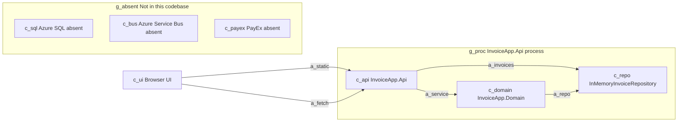
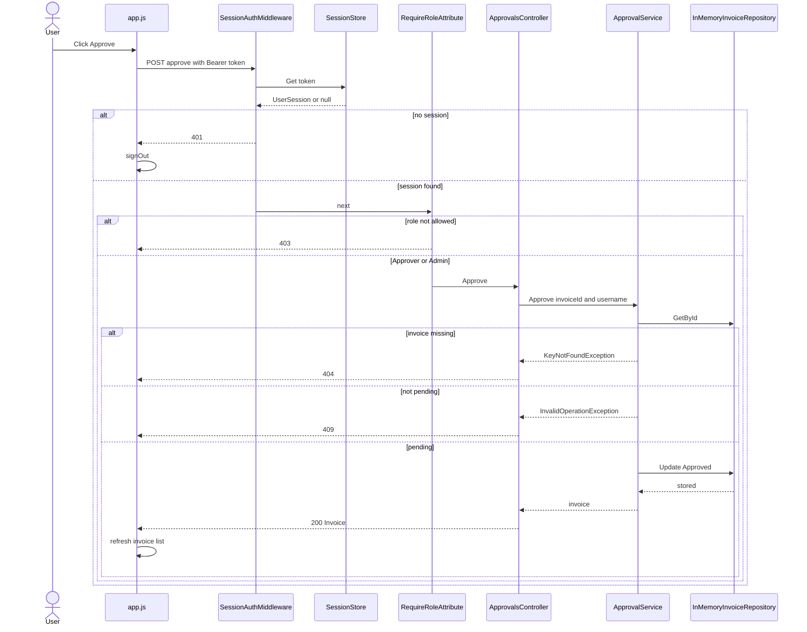

# As-built invoice approval

This is the system that runs today. Azure SQL, Azure Service Bus, and PayEx are not part of it. `ops/` describes a planned deployment.

The app is one ASP.NET Core process, the same shape as a single Spring Boot process. The browser loads static files from that process and calls its JSON API.

## Spring Boot glossary

- `InvoiceApp.Api` is the Spring Boot app. `Program.cs` is `main` plus bean registration.
- Controllers are REST controllers. Request bodies are C# `record` types, the same idea as Java records.
- `ApiControllerBase.Handle` maps failures the way a small `@ControllerAdvice` would: missing invoice is 404, illegal transition is 409, bad argument is 400.
- `SessionAuthMiddleware` is a servlet filter. Every `/api` call except `POST /api/auth/login` needs `Authorization: Bearer <token>`.
- `RequireRole` is `@PreAuthorize`. Approve and reject need Approver or Admin. Delete needs Admin. Create and submit need only a signed-in user.
- `ApprovalService` is the domain service. `IInvoiceRepository` is the repository interface. `InMemoryInvoiceRepository` is a process-local list, registered as a singleton. It is wiped when the process stops.
- `wwwroot/` is static content, like `src/main/resources/static`. The browser keeps the token in `sessionStorage`.
- xUnit `[Fact]` tests are JUnit tests. `FakeInvoiceRepository` is the test double.

## Lifecycle

`ApprovalService` is the only type that changes status. Status values are `Draft`, `PendingApproval`, `Approved`, and `Rejected`.

- Create stores a draft. `InvoicesController.Create` calls `IInvoiceRepository.Add`. A new `Invoice` starts as `Draft`.
- Submit accepts only a draft and moves it to `PendingApproval`.
- Approve and reject accept only `PendingApproval`. Reject requires a reason. Both stamp `DecidedBy` and `DecidedAt`.
- Delete removes a row and is Admin only. It does not go through `ApprovalService`.
- Nothing in this path calls a payment provider.

`DiscountCalculator` is in the Domain project and has no caller in `backend/`. It is not on the approval path. `IInvoiceRepository.GetByIds` is implemented and has no production caller.

## Container view

Four containers run. The three nodes in the absent group have no arrows.



## Approval sequence

`POST /api/approvals/{invoiceId}/approve`. Participants other than the browser are objects inside the one API process.



## Citations

### Containers and arrows

- `c_ui` — `wwwroot/index.html` loads `app.js`. `app.js` `api()` calls `fetch("/api" + path)`.
- `g_proc` — `Program.cs` builds one `WebApplication` and calls `app.Run()`. `InvoiceApp.Api.csproj` references the Domain project.
- `c_api` — `Program.cs` registers controllers, `SessionStore`, `InMemoryInvoiceRepository`, and `ApprovalService`, then `UseStaticFiles`, `UseMiddleware<SessionAuthMiddleware>`, and `MapControllers`.
- `c_domain` — `InvoiceApp.Domain.csproj` is a class library. `ApprovalService` depends on `IInvoiceRepository`. `InvoiceStatus` defines the four states.
- `c_repo` — `InMemoryInvoiceRepository` keeps a `List<Invoice>` behind a lock. Its comment says the demo runs with no database.
- `a_static` — `Program.cs` `UseDefaultFiles` and `UseStaticFiles`. `index.html` links `styles.css` and `app.js`.
- `a_fetch` — `app.js` `api()`, `decide()`, and the Approve button in `renderPending`.
- `a_service` — `ApprovalsController` and `InvoicesController` take `ApprovalService`. `Program.cs` registers `AddScoped<ApprovalService>()`.
- `a_invoices` — `InvoicesController` calls `IInvoiceRepository` directly from `GetAll`, `GetById`, `Create`, and `Delete`.
- `a_repo` — `ApprovalService.Find` calls `GetById`. `Approve`, `Reject`, and `Submit` call `Update`.
- `c_sql` — no SQL client or connection string under `backend/`. The name appears in `ops/`, which is the planned deployment.
- `c_bus` — no Service Bus client under `backend/`. The name appears in `ops/`.
- `c_payex` — no PayEx type under `backend/`. The name appears in `ops/` incident text, including `PayExClient` in `ops/incidents/INC-2041/app-logs.txt`. That file is scenario evidence, not a class in this repo.
- `g_absent` — those three nodes have no arrows. Nothing under `backend/` calls them.

### Sequence

- `User` — the Approve button listener in `app.js` `renderPending`.
- `UI` — `wwwroot/app.js`: `api`, `decide`, `signOut`, `refresh`, `showError`.
- `MW` — `SessionAuthMiddleware.InvokeAsync`.
- `SS` — `SessionStore.Get`. `AuthController.Login` creates sessions with `SessionStore.Create`.
- `RR` — `RequireRoleAttribute.OnActionExecuting`. The controller is marked `[RequireRole("Approver", "Admin")]`.
- `AC` — `ApprovalsController.Approve` and `ApiControllerBase.Handle`.
- `AS` — `ApprovalService.Approve`, `Find`, and `EnsurePending`.
- `IR` — `InMemoryInvoiceRepository.GetById` and `Update`.
- `Click Approve` — `renderPending` builds the button only when `status === "PendingApproval"`.
- `POST approve with Bearer token` — `decide` posts `/approvals/${invoice.id}/approve` with `{}`. `api()` adds the bearer token. The route is `api/[controller]` plus `[HttpPost("{invoiceId}/approve")]`.
- `Get token` — the middleware strips the `Bearer ` prefix and calls `SessionStore.Get`.
- `UserSession or null` — `SessionStore.Get`. `UserSession` is `(Username, Role)`.
- `401` — the middleware sets status 401 and returns without calling `_next`.
- `signOut` — `api()` on 401 calls `signOut()`, which posts `/api/auth/logout` and clears `sessionStorage`.
- `next` — `InvokeAsync` calls `await _next(context)` after storing the session on `HttpContext.Items`.
- `403` — `RequireRoleAttribute` sets `StatusCodeResult(403)` when the role is missing.
- `Approve` — MVC invokes `ApprovalsController.Approve` when the filter allows the request.
- `Approve invoiceId and username` — `Approve` calls `Handle(() => _approvals.Approve(invoiceId, HttpContext.GetSession().Username))`.
- `GetById` — `ApprovalService.Find`.
- `KeyNotFoundException` — `Find` when `GetById` returns null.
- `404` — `Handle` catches `KeyNotFoundException` and returns `NotFound`.
- `InvalidOperationException` — `EnsurePending` when the status is not `PendingApproval`.
- `409` — `Handle` catches `InvalidOperationException` and returns `Conflict`.
- `Update Approved` — `Approve` sets `Status`, `DecidedBy`, and `DecidedAt`, then calls `Update`.
- `stored` — `Update` replaces the list slot for that id.
- `invoice` — `Approve` returns the invoice to `Handle`.
- `200 Invoice` — `Handle` returns `Ok(invoice)`. `Program.cs` adds `JsonStringEnumConverter`, so the status is the enum name.
- `refresh invoice list` — `decide` calls `refresh()`, which `GET`s `/api/invoices`.

`ApprovalService.Approve` does not throw `ArgumentException`. `Reject` does, when the reason is blank, and `Handle` maps that to 400.

## Inferred

- Sequence participants other than the browser are not separate services. `Program.cs` builds one `WebApplication`. `SessionStore` is a singleton in that process. The diagram splits them so the call order is visible.
- Invoices and sessions do not survive a process restart. Both stores are in-memory fields, and no startup code reloads them. `InMemoryInvoiceRepository` says the demo runs with no database.
- `app.js` calls `/api/approvals/...` in lowercase. The route template uses the class name `Approvals`. ASP.NET Core matches routes without case sensitivity by default. This repo does not set a route policy.
- JSON fields arrive as camelCase (`status`, `customerName`, `error`). `Program.cs` does not set a naming policy. That is the ASP.NET Core `System.Text.Json` default. The enum converter is the only JSON option set in this repo.
- This repo never calls `RequireRoleAttribute` or `Approve` directly. `SessionAuthMiddleware` calls `_next`. MVC runs the filter and, when the filter leaves `Result` unset, the action.
- The 403 result has no `{ error }` body. `app.js` then shows `Request failed (403)`.
- `UseStaticFiles` does not serve `POST /api/...`. The request reaches the auth middleware because of the order in `Program.cs`.

## Corrections to the first draft

The first draft drew the repository only behind `ApprovalService`. `InvoicesController` also calls `GetAll`, `GetById`, `Add`, and `Remove` itself. The container view now has arrow `a_invoices`.

The first draft named `PayExClient` as a symbol to look for. That name is in `ops/` incident text. There is no such type under `backend/`. The absent node stays, with that distinction.

## Architecture test

`DomainBoundaryTests` encodes the rule that the Domain assembly does not reference the web host.

```bash
dotnet test backend/InvoiceApp.sln --filter DomainBoundaryTests
```

## Rendered diagrams

The Mermaid source above is the hand-in. Both diagrams were rendered by the `mcp-mermaid` server (`npx -y mcp-mermaid@0.4.1`), tool `generate_mermaid_diagram`, output type `svg`:

- `docs/architecture/as-built-containers.svg`
- `docs/architecture/as-built-approval-sequence.svg`

This Cursor session had not attached that server yet, so the call was made to the server process directly. The same server is declared in `.mcp.json` and `.cursor/mcp.json`. Enable it in Cursor to call it from later turns.
