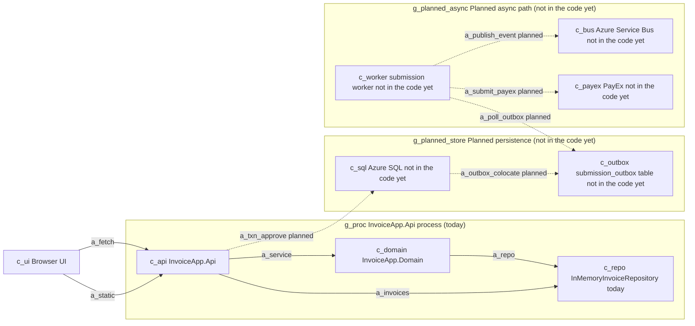
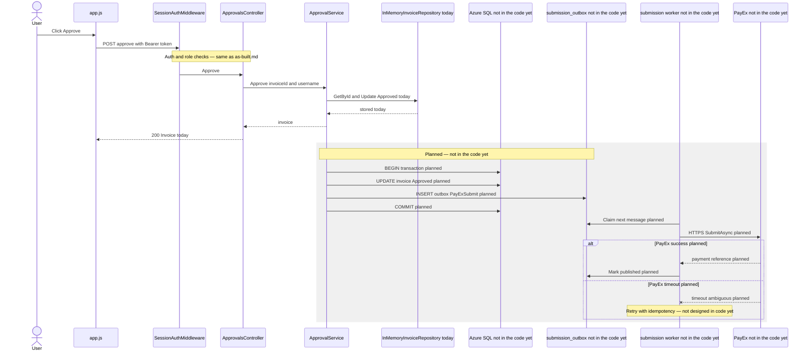

# Target invoice approval (planned production)

This is the **planned** shape for production. It is not what runs today.

For what exists in the repo now, see [as-built.md](./as-built.md). Every node and arrow below that is not already in as-built is labeled **not in the code yet**. Dashed arrows are **planned** hops only; they are not implemented under `backend/`.

`ops/README.md` states that the database, message topic, and PayEx integration are assumed for the going-to-production story but absent from application code. Incident packs under `ops/incidents/` use invented production names (for example `PayExClient` in log exports); those are scenario evidence, not types in this repository.

## As-built vs target (summary)

| Piece | Today ([as-built](./as-built.md)) | Target (this doc) |
| --- | --- | --- |
| Invoice persistence | `InMemoryInvoiceRepository` in the API process | Azure SQL **not in the code yet** |
| Approval side effects | `ApprovalService.Approve` → `IInvoiceRepository.Update` only | Same approve API path, plus transactional outbox row **not in the code yet** |
| PayEx submission | None | Submission worker → PayEx HTTPS **not in the code yet** |
| Messaging | None | Azure Service Bus topic (provisioned in scenario; unused in code) **not in the code yet** |

## Container view (target)

Solid arrows match the as-built process. Dashed arrows are planned production wiring only.



The arrow **`a_submit_payex`** is the clearest example of something that **must not** be claimed as implemented today: there is no PayEx client, HTTP call, or worker under `backend/`. Today, `ApprovalService.Approve` ends at `Update` on the in-memory repository.

## Submission sequence (target)

The HTTP approve path through `ApprovalService` matches as-built through persistence. Everything after the planned transactional commit is **not in the code yet**.



In the running demo, the sequence **stops** when `InMemoryInvoiceRepository.Update` returns. The grey `rect` block is the production gap the ADR and policies must close.

## Citations

### Containers and arrows (today — same as as-built)

- `c_ui` — `wwwroot/app.js` `api()` and `renderPending`.
- `g_proc` — `Program.cs` single `WebApplication`.
- `c_api` — `Program.cs` controller and middleware registration.
- `c_domain` — `ApprovalService` in `backend/src/InvoiceApp.Domain/ApprovalService.cs`.
- `c_repo` — `InMemoryInvoiceRepository` in `backend/src/InvoiceApp.Api/`.
- `a_static`, `a_fetch`, `a_service`, `a_invoices`, `a_repo` — same citations as [as-built.md](./as-built.md#containers-and-arrows).

### Containers and arrows (planned — ops scenario, not backend/)

- `c_sql` — `ops/README.md` ("a database"). No SQL client or connection string under `backend/`.
- `c_outbox` — transactional outbox pattern assumed in workshop stories (`stories/02-adr-explore-with-agent.md` option B). No outbox table or type in `backend/`.
- `c_worker` — `ops/incidents/INC-2047/worker-logs.txt` names a `notification-worker` against topic `invoice-events`; that pack is about notifications, not this repo's code. Target names a separate **submission worker** for PayEx exactly-once (planned component).
- `c_bus` — `ops/README.md` ("a message topic"). `ops/incidents/INC-2047/servicebus-status.txt` topic `invoice-events`, subscription `notification-worker`. No Service Bus SDK usage under `backend/`.
- `c_payex` — `ops/README.md` and `ops/incidents/INC-2041/README.md`. `PayExClient` appears only in `ops/incidents/INC-2041/deploy-diff.patch` and log files, not in `backend/`.
- `a_txn_approve` — planned single transaction for approve + outbox insert; not implemented. Workshop peak ~80 approvals/minute: `stories/notes/scenario-facts.md`.
- `a_outbox_colocate` — planned outbox table in the same database as invoices (target pattern for exactly-once).
- `a_poll_outbox` — planned worker claiming outbox rows; no worker project in repo.
- `a_publish_event` — planned publish to Service Bus for downstream consumers (aligned with provisioned topic in ops packs).
- `a_submit_payex` — planned HTTPS submit; PayEx 30s timeout with ambiguous failure: `stories/notes/scenario-facts.md`, `ops/incidents/INC-2041/README.md`.

### Sequence (today)

- Through `200 Invoice today` — citations match [as-built.md](./as-built.md#sequence): `ApprovalsController.Approve`, `ApprovalService.Approve`, `InMemoryInvoiceRepository.Update`.

### Sequence (planned)

- `SQL`, `OB`, `WK`, `PX` participants — **not in the code yet**; names grounded in `ops/README.md` and story option B (`stories/02-adr-explore-with-agent.md`).
- `BEGIN transaction` through `COMMIT planned` — planned transactional outbox on approve; `ApprovalService.Approve` today has no outbox call (see `ApprovalService.cs` lines 31–40).
- `Claim next message`, `SubmitAsync`, timeout branch — planned worker behavior; `grep PayEx backend/` returns no matches.

## Inferred

- Target keeps the existing browser and synchronous approve API so approvers still get an immediate 200 while submission moves async — common pattern when PayEx latency and timeouts must not block the UI thread.
- `submission worker` is drawn as a separate process from `InvoiceApp.Api` so submission retries and PayEx rate limits do not share the web tier's scale unit (App Service in scenario: `stories/notes/scenario-facts.md`).
- Service Bus is included because the scenario already provisions a topic (`invoice-events`); the target uses it for event fan-out while the worker still owns the PayEx call for exactly-once semantics (exact split is for the ADR — not decided in code).
- The sequence grey block could be collapsed into one API process before SQL migration; the diagram separates participants for the same reason as as-built: call order visibility.
- Replacing `InMemoryInvoiceRepository` with SQL is a migration step; until then, only the solid arrows in the container view run locally.

## Architecture test

Unchanged from as-built — Domain must not reference the web host:

```bash
dotnet test backend/InvoiceApp.sln --filter DomainBoundaryTests
```

(Use your local `dotnet` if it is not on `PATH`; for example `~/.dotnet/dotnet`.)

## Rendered diagrams

Optional hand-in SVGs (Mermaid source above is sufficient):

- `docs/architecture/target-containers.svg`
- `docs/architecture/target-approval-sequence.svg`

Render with the `mcp-mermaid` server declared in `.cursor/mcp.json` when enabled in Cursor.
